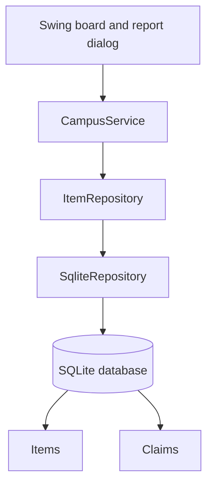

# Design and implementation

The Swing frame creates forms and displays records. The CampusService depends on the ItemRepository interface. SqliteRepository implements that interface with JDBC and stores data in a local SQLite file.

## Workflow and storage

| State | Next action | Rule |
| --- | --- | --- |
| Open lost report | Edit or search | Ownership claims apply to found reports |
| Open found report | Edit or record claim | Claimant and verification notes are required |
| Claimed | Confirm handover | A current claim must exist |
| Returned | View history | The return timestamp remains available |

The items table holds type, name, category, location, incident date, description, photo and status. A claims row holds the item ID, claimant, evidence and UTC timestamps. Its item ID is a primary key and a foreign key.

The UI confirms the handover before writing. The DAO checks the previous state in its UPDATE and writes both tables in one transaction. If either write fails, SQLite rolls back both changes. JUnit forces a failure between the two writes and tests competing claims against the same report.

## Limitations and future scope

The app is intended for a local campus desk. It requires staff verification of each claim and supports a single claim per found report. A future rollout could add operator sign-in, multi-desk collaboration and a workflow to close matching lost reports.
